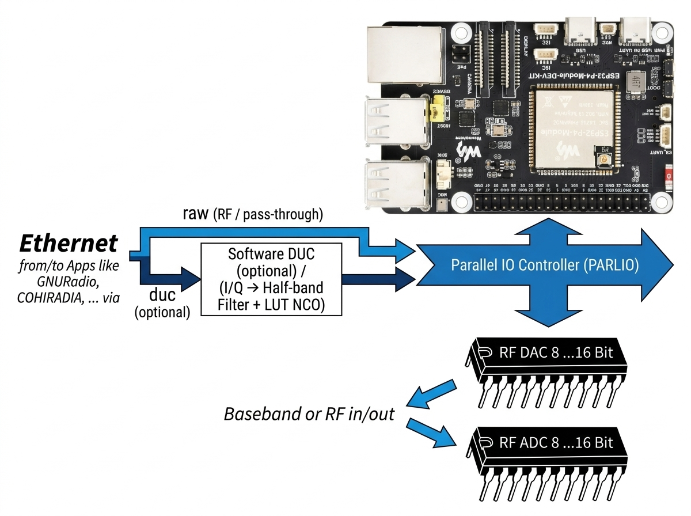

# parlioSDR  [ESP32 based Software-Defined-Radio TX]

Baseband/RF over Ethernet - powered by ESP32-P4 PARLIO/Parallel IO Interface (DMA - driven).



For high-speed connection of a DAC/ADC in SDR applications, some new MCUs from espressif, like ESP32-P4, offers the PARLIO/Parallel IO Interface.
https://docs.espressif.com/projects/esp-idf/en/stable/esp32p4/api-reference/peripherals/parlio/index.html

This interface is very well suited for price-sensitive experiments (rx and tx) in the field of software-defined radio.
The project shown here is a feasibility study on how to send such baseband or RF data from an application like GNU Radio or Cohiradia to an ESP32-P4 via Ethernet.

Although Espressif's new microcontrollers (S31 ...) are Gigabit-capable and can therefore be a good alternative to the smisdr (Raspberry 4 / https://github.com/radiolab81/smisdr), the existing P4 dev-boards are not making use of this yet, so the bandwidth is still somewhat limited, but it is sufficient for projects such as AMWaveSynth (https://github.com/radiolab81/AMWaveSynth) or Cohiradia (https://github.com/radiolab81/COHIRADIAStreamer). As an alternative to Ethernet, we are planning to evaluate the USB 2.0 interface, which should overcome this bandwidth limitation for many applications, please see https://github.com/radiolab81/parlioSDRUSB 

The parlioSDR represents a very cost-effective approach/replacement to the obsolete FL2000 USB-VGA adapter (8-bit only) in some cases. Usable DACs range from simple 8-10 bit R2R-ladder-DACs to common 12-14 bit parallel-DACs (and ADCs) from manufacturers like Analog, Microchip, or TI. The ability to easily build your own HATs with the desired bit width provides access to all frequency ranges within signal bandwidth corresponding to the PARLIO-Interface.

The project is build with actual ESP-IDF 6.1, so this few lines can do the job (provided that the correct chip revision and CPU clock frequency for your board are set in “menuconfig”; PSRAM is enabled; and the correct header file containing your board's pin assignment has been selected in main.c)

```console
idf.py build

idf.py -p YOUR_PORT flash

idf.py -p YOUR_PORT monitor
```
Immediately after starting, parlioSDR waits for an IP address, which should preferably be provided via DHCP.

```
I (2157) esp_eth.netif.netif_glue: ethernet attached to netif
I (4857) PARLIOSDR: Hardware Loop neugestartet: 8 Bit, 5.00 MSPS
I (4857) main_task: Returned from app_main()
I (4857) PARLIOSDR: Warte auf TCP Daten-Verbindung (Port 1234)...
I (4857) PARLIOSDR: Control-Server lauscht auf Port 5000
I (7357) esp_netif_handlers: eth ip: 192.168.1.71, mask: 255.255.255.0, gw: 192.168.1.1
I (7357) PARLIOSDR: Ethernet OK! IP: 192.168.1.71
```
Like the smisdr, it expects the RF data stream on port 1234, and can listen for the same control commands via port 5000, just like its larger Raspberry Pi sibling.

for example:

#### set sample rate to 5 MSPS
echo -n "rate 5" | nc -w 1 192.168.1.71 5000

#### set sample rate to 10 MSPS
echo -n "rate 10" | nc -w 1 192.168.1.71 5000

#### set sample rate to 12.5 MSPS
echo -n "rate 12.5" | nc -w 1 192.168.1.71 5000

#### set 8 bit dac width
echo -n "width 8" | nc -w 1 192.168.1.71 5000

#### set 16 bit dac width
echo -n "width 16" | nc -w 1 192.168.1.71 5000

Apps like COHIRADIAStreamer (https://github.com/radiolab81/COHIRADIAStreamer) will do the config on-the-fly.

The pin assignment of the header to the DAC (or ADC) is shown in esp32_p4_***.h files.

## Two modes: pass-through or software DUC

parlioSDR streams samples from Ethernet to a parallel DAC through the ESP32-P4 PARLIO peripheral.
Since v2.0 it can run in two modes, switchable at runtime on the control port:

| | `raw` (default) | `duc` |
|---|---|---|
| Input on port 1234 | finished RF samples, or I/Q for an FPGA | I/Q stream of the COHIRADIAStreamer *I/Q engine* |
| Up-conversion | on the PC, or in the FPGA | on the ESP32 (half-band interpolation + LUT NCO) |
| Extra hardware | none (or FPGA) | none |
| Switch | `echo -n "mode raw" \| nc -w 1 <ip> 5000` | `echo -n "mode duc" \| nc -w 1 <ip> 5000` |

`raw` behaves exactly as before. In `duc` mode the ESP32 replaces the FPGA: it decodes the in-band
commands (`S` = shift, `R` = sample rate), interpolates, mixes up and drives the DAC itself.
Tested with 8 to 14 bit DACs in both modes, at 250 kSps and 1.25 MSps input, and up to shortwave
(for example a 6.09 MHz carrier at 10 MSPS using the first image, which needs a band-pass filter).
See [Software DUC mode](#software-duc-mode-iq-in-mixed-rf-out---instead-of-an-fpga) for commands, limits and CPU load.

## Software DUC mode (I/Q in, mixed RF out - instead of an FPGA)

parlioSDR now has two operating modes for the data port (1234):

| mode | what the ESP32 does | default |
|---|---|---|
| `raw` | unchanged behavior described above: the stream (finished RF samples, or I/Q for an FPGA) is passed 1:1 to the PARLIO DMA ring | yes |
| `duc` | the ESP32 takes over the job of the FPGA: it expects the I/Q stream of the COHIRADIAStreamer *I/Q engine*, interpolates (half-band filters + ramp), mixes up with a LUT-NCO (`I·cos − Q·sin`) and drives PARLIO itself | no |

The DSP core (`sdr_dsp.c`) and the rate planner (`sdr_plan.c`) are taken unchanged from the
[COHI-Player-ESP32](https://github.com/radiolab81/COHI-Player-ESP32) (player from SD card), where they are proven on hardware.
In `raw` mode none of the new code runs; the original code path is untouched.

```
echo -n "mode duc" | nc -w 1 192.168.1.71 5000      # switch to the software DUC
echo -n "mode raw" | nc -w 1 192.168.1.71 5000      # back to pass-through (restores the last rate/width)
echo -n "mode"     | nc -w 1 192.168.1.71 5000      # query
```

Select the **I/Q engine** in the streamer as you do for an FPGA. Nothing else changes on the PC side.
The stream is the same as for the FPGA (16-bit little-endian words, tag in bit 15:14):

| tag | meaning |
|---|---|
| `00` / `01` | I / Q sample, 14 bit two's complement (the DUC scales it back to 16 bit) |
| `10` | command word: index 63 = start command (`'S'` shift, `'R'` input sample rate), index 0..3 = FTW bytes (LSB first) |
| `11` | execute (`'E'`) |

`S` and `R` carry an FTW relative to the 50 MHz FPGA clock (`DUC_FPGA_REF_HZ` in `duc_proto.h`, same as `calculate_ftw()` in the
streamer). The DUC converts them back to Hz, so the **exact** input sample rate and shift come from the stream. A new `S` in
the stream retunes without a gap (phase continuous); a new `R` re-plans the output clock (rest of the old signal is played out first).

What the existing control commands mean in `duc` mode:

* `rate x` (the streamer sends the bus rate = 2·fs, rounded to 0.1 MSPS) is only remembered as a fallback in case the stream contains no `R`.
* `width x` (the streamer always sends 16 = bus width to the FPGA) is ignored. The width of the DAC on this board is set separately with `duc width`.

Additional commands (every answer ends with a newline, so `nc` shows it):

```
duc status                 settings and, during a session, fs / shift / N / PARLIO clock / DSP load / lead / underruns / gain
duc width 8|16             DAC width at the PARLIO pins (default 16, build default DUC_DEFAULT_WIDTH)
duc offset on|off          offset binary (unsigned DACs / R2R ladders: on)
duc gain auto|0.01..4.0    AGC (default, target 50 %) or fixed gain - takes effect live
duc cores auto|1|2         mixer on one or two cores (auto: second core if estimated load >= 50 %, `DUC_AUTO_2CORE_PCT`)
duc maxrate <MHz>          highest allowed PARLIO clock (default 10 MHz)
```
Everything except `duc gain` takes effect with the next data connection.

Output rate: `Fs_out = N · fs`, N = 4, 8, 12, … the smallest N for which `Fs_out` divides 160 MHz exactly and the carrier plus
sideband stay below Nyquist (see the COHI-Player-ESP32 README for the table, the load estimates and the alias case). A warning
is logged when the signal can only be generated as an alias/image, or when the load is too high.
Ring handling is the same as in the player: the write pointer is kept ~60..100 ms ahead of the DMA, underruns are counted
(`duc status`) and never replay old data.

Building: nothing to configure; `main/CMakeLists.txt` compiles `sdr_dsp.c` with `-O3` (the project default is `-Os`).
To boot straight into the DUC: `-DPARLIOSDR_DEFAULT_MODE=SDR_MODE_DUC`. Notes:

* `sdkconfig` of this project is set up for the DUC (tested): ESP32-P4 rev >= 3.01 at 400 MHz, PSRAM enabled (80 MHz),
  `-O2` (`COMPILER_OPTIMIZATION_PERF`), `CONFIG_FREERTOS_HZ=1000`, `CONFIG_LWIP_TCP_WND_DEFAULT=16384` and
  `CONFIG_LWIP_TCP_RECVMBOX_SIZE=16` (must cover window / MSS = 16384 / 1440 = 12 segments). `./check_settings.sh` lists them.
  The larger TCP window is needed because the DUC applies back-pressure (the ring is only filled ~100 ms ahead); with 5760 bytes
  a 1.25 MSps I/Q stream (5 MB/s) stutters, 250 kSps does not. Raw mode is unaffected by these values (tested).
* No SD card is involved, so GPIO45 etc. are not special here (see COHI-Player-ESP32 if you combine both projects).

Host tests (no hardware): `test/host_duc.c` builds the stream exactly like `DspWorker::run_IQ_engine`, checks the parser with
random chunking (1 byte … 1.5 kB), error cases, FTW conversion, and runs parser → planner → DSP; `test/analyze_duc.py` checks the spectrum.

```
gcc -O2 -I main -o test/host_duc test/host_duc.c main/duc_proto.c main/sdr_dsp.c main/sdr_plan.c -lm
./test/host_duc /tmp/duc_out.bin && python3 test/analyze_duc.py /tmp/duc_out.bin
```

## Using with GNU Radio

parlioSDR shares its DNA with our sister-project smiSDR (for the Raspberry Pi), so see https://github.com/radiolab81/smisdr#using-with-gnu-radio

